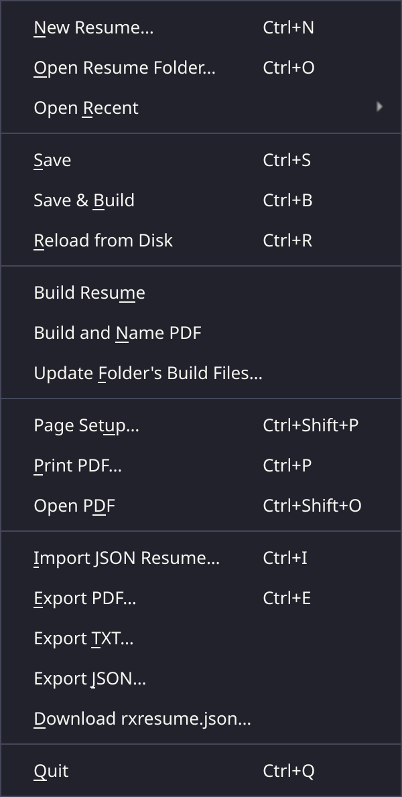
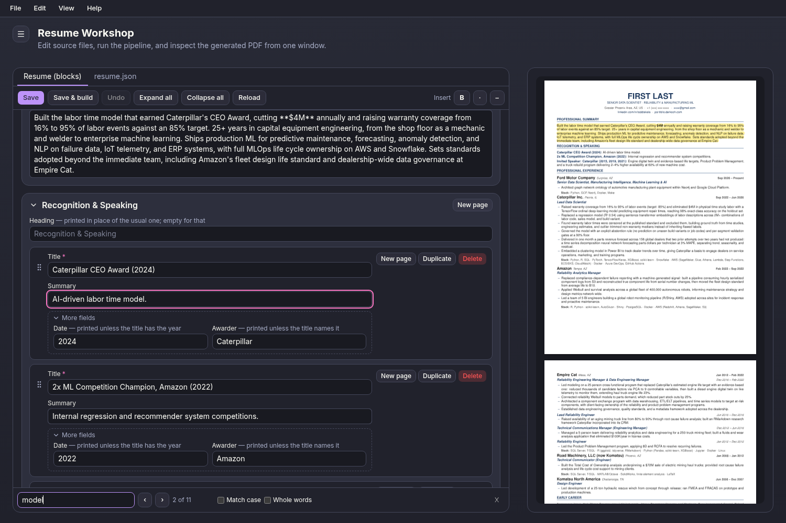
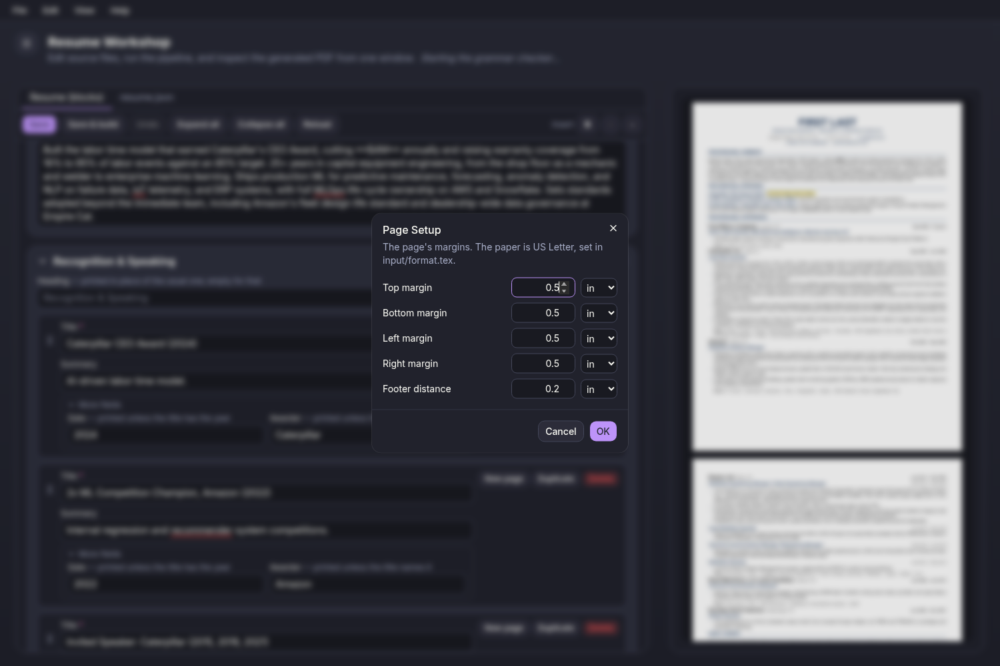

# Resume Workshop

Resume Workshop is a source-driven LaTeX resume builder. The resume's content
lives in a single [JSON Resume](https://jsonresume.org/schema) document, with
page geometry and section order in small YAML files and the layout in a TeX
file. Standard-library Python generators turn those inputs into interim LaTeX,
and Make targets build the final PDF and plain-text resume, plus a
[Reactive Resume](https://rxresu.me) export for importing there. The project also
includes an optional desktop editor with a drag-and-drop block view of
the resume, and a Docker-based build path for a reproducible toolchain.


## Contents

- [Resume Workshop](#resume-workshop)
  - [Contents](#contents)
  - [Requirements](#requirements)
  - [Quick start](#quick-start)
  - [Project layout](#project-layout)
  - [Make targets](#make-targets)
  - [Editing the resume](#editing-the-resume)
  - [Local editor](#local-editor)
  - [Reactive Resume export](#reactive-resume-export)
  - [Generated files](#generated-files)
  - [Docker workflow](#docker-workflow)
  - [Spell checking](#spell-checking)
  - [Credits](#credits)

## Requirements

For a native build, install Python 3.13 or newer, GNU Make, and a TeX Live
installation with the packages used by [input/format.tex](input/format.tex).
The resume generators use only the Python standard library, so
`make build` needs no pip packages. `make validate` and the optional desktop
editor do: run `pip install -r requirements.txt` first, which installs
jsonschema and, for the editor, [PySide6](https://doc.qt.io/qtforpython-6/)
(Qt for Python) and its spelling checker. Its grammar checker is a separate,
optional install (see [Spelling and grammar](#spelling-and-grammar) for what
both need).

If LaTeX is not installed locally, use the Docker workflow instead.

## Quick start

1. Edit [input/resume.json](input/resume.json), either by hand or in the
   desktop editor (`make editor`).
2. Run `make build`.
3. Open `output/resume.pdf` or `output/resume.txt`.

To create a filename based on the name in the header, run `make user` (for
example, "Todd Takala" gives `output/todd_takala_resume.pdf`).

Example output: [resume.pdf](output/resume.pdf) and
[resume.txt](output/resume.txt).

## Project layout

- [input/](input/) contains the resume content (`resume.json`), section order, page geometry, and LaTeX layout.
- [scripts/](scripts/) contains the standard-library Python generators, and the schema validator.
- [editor/](editor/) contains the Qt desktop editor.
- [interim/](interim/) contains generated LaTeX fragments used during a build.
- [output/](output/) contains the generated PDF and plain-text resumes, the Reactive Resume export (`rxresume.json`), and the resume schema (`resume-workshop.json`).
- [packaging/](packaging/) builds and installs the editor as an AppImage, and [.github/workflows/](.github/workflows/) publishes it as a release.
- [docker/](docker/) contains the reproducible build image definition.
- [docs/screenshots/](docs/screenshots/) contains the editor screenshots used in this README.
- [etc/](etc/) contains the vendored JSON Resume and Reactive Resume schemas, cspell configuration, and project-specific words.

## Make targets

- `make build` regenerates all interim files, then creates `output/resume.pdf`, `output/resume.txt`, `output/rxresume.json`, and `output/resume-workshop.json`.
- `make pdf` creates just `output/resume.pdf`, without the text and Reactive Resume versions.
- `make txt` creates just `output/resume.txt`, written from the same inputs as the PDF by [scripts/generate_text.py](scripts/generate_text.py).
- `make header` regenerates `interim/header.tex` from the `basics` in [input/resume.json](input/resume.json) without a full build.
- `make geometry` regenerates `interim/geometry.tex` from [input/geometry.yaml](input/geometry.yaml) without a full build.
- `make resume` regenerates `interim/resume_content.tex` from [input/resume.json](input/resume.json) and [input/section_order.yaml](input/section_order.yaml) without a full build.
- `make rxresume` writes `output/rxresume.json`, the resume as a [Reactive Resume](https://rxresu.me) document (see [Reactive Resume export](#reactive-resume-export)), without a full build.
- `make schema` writes `output/resume-workshop.json`, the JSON Resume schema with this project's extension fields added (see [Editing the resume](#editing-the-resume)), without a full build.
- `make validate` checks [input/resume.json](input/resume.json) against the JSON Resume schema and the generator's rules, and the Reactive Resume export against its schema.
- `make user` creates `output/<name>_resume.pdf`, where `<name>` is the `basics.name`
  field from [input/resume.json](input/resume.json), lowercased, with spaces
  replaced by underscores and everything else reduced to alphanumerics/underscores
  (for example, "Todd Takala" gives `output/todd_takala_resume.pdf`).
- `make editor` opens the desktop editor: a drag-and-drop block view of
  the resume, a raw `resume.json` tab, and a live preview of the PDF; see
  [Local editor](#local-editor).
- `make appimage` packages the editor as an AppImage, and `make install-appimage`
  installs it; see [Installing the editor](#installing-the-editor).
- `make clean` removes auxiliary pdflatex files and generated interim files.
- `make docker-image` builds the local `resume-builder` Docker image.
- `make docker-build` builds a Docker image with pdflatex and python3 and
  runs `make build` inside a container against this directory — use this if
  you don't have LaTeX installed locally. Output files
  land in the `output/` directory, owned by your user, same as a native build.

## Editing the resume

All resume content, including the contact header, lives in
[input/resume.json](input/resume.json), a [JSON Resume](https://jsonresume.org/schema)
document. Because it follows that community schema, the same file also works
with JSON Resume themes, the registry, and other tools. `make build` (or
`make header` / `make resume`) renders it into `interim/header.tex` and
`interim/resume_content.tex`, which [input/format.tex](input/format.tex)
pulls in via `\input`. Both are generated (git-ignored), so don't edit them directly.

Write the text as plain text, not LaTeX: use `&`, `%`, `·` (middle dot), and
`–` (en dash) directly, and the generators escape them for LaTeX (`·` prints
as `$\cdot$`, `–` as `--`). Dates are ISO 8601 (`2012-01`, or just `2005`) and
print as `Jan 2012` / `2005`. A role with no `endDate` prints as `Present`.

Every section of the JSON Resume schema has a resume section. This is how
the fields map onto the printed resume (the section id is what
`section_order.yaml` uses):

| Printed (section id) | JSON Resume |
| --- | --- |
| Header | `basics`: `name`, `label` (title), `location.city`/`region`, `phone`, `email`, then `url` and `profiles[].url` as links. A link's text is its URL without the scheme or `www.`, cut off after the profile's `username` |
| Professional Summary (`summary`) | `basics.summary` |
| Professional Experience (`experience`) | `work[]`, one entry per position. Consecutive entries with the same `name` and `location` print as one employer with several roles. A role prints its `summary` (if any) above its `highlights` bullets |
| Early Career (`early_career`) | `work[]` entries with `"earlyCareer": true`, printed as `position, name (years), summary` |
| Volunteer Experience (`volunteer`) | `volunteer[]`: `organization`, dates, `position`, `summary`, and `highlights` bullets, laid out like a job |
| Education (`education`) | `education[]`: `studyType in area, institution, score`, the `startDate`–`endDate` years, and `courses` joined with `·` on a line below |
| Selected Certifications (`certifications`) | `certificates[]`: `name, issuer` |
| Recognition & Speaking (`recognition`) | `awards[]`: `title` and `summary` |
| Publications (`publications`) | `publications[]`: `name`, then `publisher (year). summary` |
| Selected Independent Projects (`projects`) | `projects[]`: `name` and `description`, `highlights` bullets, and `keywords` as a Stack line |
| Languages (`languages`) | `languages[]`: `language (fluency)`, joined with `·` |
| Interests (`interests`) | `interests[]`: `name`, then `keywords` joined with `·` |
| References (`references`) | `references[]`: `name` and `reference` |
| Core Competencies (`competencies`) | `skills[]`: `name (level)`, then `keywords` joined with `·` |

Fields not listed above are kept in the file and editable in the block
editor, but aren't printed: `basics.image`, `location.address`/`postalCode`/`countryCode`,
the `url` on entries (only `basics.url` and the profile links print),
`work[].description`, an early-career entry's `location` and `highlights`,
award `date`/`awarder`, certificate `date`, project `roles`/`entity`/`type`/dates,
and `meta`.

[input/section_order.yaml](input/section_order.yaml) sets the order of these
sections; omit a section to leave it out of the resume. All of them are listed
by default, and a section with no entries in `resume.json` (no `volunteer[]`,
say) is skipped, along with any page break before it, so it starts printing
once you add an entry. A `- pagebreak` line starts the section after it on a
new page. The block editor's Sections card and **New page** toggles edit this
file for you.

The schema allows extra fields on any entry, and a few LaTeX-specific ones
are used:

- `pagebreakBefore`: `true` on any section entry (a role, skill, education,
  certificate, award, project, and so on) starts that entry on a new page. On
  the first entry of a section, the section heading moves to the new page
  too; on an employer's first role, the employer's name does.
- `stack` (`work[]`): a tools line printed under that role.
- `companyStack` (`work[]`): a tools line printed once after all of that
  employer's roles, for when several roles share the same tools. Set it on the
  employer's first entry.
- `earlyCareer` (`work[]`): `true` moves the entry to the Early Career section.

[output/resume-workshop.json](output/resume-workshop.json) is the JSON Resume
schema with these fields added, typed, and described. `make build` (or
`make schema`) generates it from [etc/resume-schema.json](etc/resume-schema.json)
with [scripts/generate_schema.py](scripts/generate_schema.py). To have an editor
check and autocomplete them, point `resume.json`'s `$schema` at it:

```json
"$schema": "https://raw.githubusercontent.com/forloop11/resume-workshop/main/output/resume-workshop.json"
```

It doesn't cover the per-section rules (such as a role needing highlights or
a summary); `make validate` checks those.

```json
{
  "name": "Empire Cat",
  "location": "Mesa, AZ",
  "position": "Technical Communications Manager (Engineering Manager)",
  "startDate": "2012-12",
  "endDate": "2016-06",
  "highlights": ["..."],
  "pagebreakBefore": true
}
```

Run `make validate` to check `input/resume.json` against the schema (the
[JSON Resume](https://jsonresume.org/) project's v1.2.1 schema, vendored at
[etc/resume-schema.json](etc/resume-schema.json); see [Credits](#credits)) and
against the fields each section in `section_order.yaml` needs, then checks
the [Reactive Resume export](#reactive-resume-export) against its schema. This needs
`jsonschema` from `requirements.txt`; `make build` itself doesn't.

Page geometry lives in [input/geometry.yaml](input/geometry.yaml). Edit that
file, or use the editor's [Page Setup](#page-setup), and run `make build` (or
`make geometry`) to regenerate `interim/geometry.tex`. The [input/format.tex](input/format.tex) file contains
the LaTeX layout, commands, and document configuration.

## Local editor

Run `make editor` to open the editor window. It's a [Qt](https://www.qt.io/)
app in [editor/](editor/), written in Python with PySide6, so it needs the
packages in `requirements.txt` (`pip install -r requirements.txt`). To run
it without a checkout or those packages, download the AppImage: see
[Installing the editor](#installing-the-editor).


The window has two tabs on the left, **Resume (blocks)** and `resume.json`,
and a live preview of the PDF on the right. Drag the gap between them to
resize them.

- Messages about saves and builds appear under the window's title.
- A dot on a tab marks unsaved changes. Closing the window, reloading the
  files, or switching to another resume with any asks first.
- After a build, pdflatex's output is in a **Last build output** box above
  the preview, which opens by itself if the build failed.

### Menus

Every command is in the menu bar:



- **File**
  - New Resume (Ctrl+N), Open Resume Folder (Ctrl+O), and Open Recent: see
    [Resume folders](#resume-folders).
  - Save (Ctrl+S) and Save & Build (Ctrl+B) act on the tab that is showing.
    Reload from Disk (Ctrl+R) rereads the files in `input/`.
  - Build Resume and Build and Name PDF do what `make build` and
    `make user` do: see [Building](#building).
  - Page Setup (Ctrl+Shift+P): see [Page Setup](#page-setup).
  - Print PDF (Ctrl+P), Open PDF (Ctrl+Shift+O), Import JSON Resume (Ctrl+I),
    Export PDF (Ctrl+E), Export TXT, Export JSON, and Download rxresume.json:
    see [Printing, exporting, and importing](#printing-exporting-and-importing).
  - Quit (Ctrl+Q).
- **Edit**
  - Undo, Redo, Cut, Copy, Paste, and Select All act on the text box you're
    in.
  - Undo Block Change (Ctrl+Alt+Z) is the block editor's own **Undo**.
  - Find (Ctrl+F), Find Next (F3), Find Previous (Shift+F3), and Replace
    (Ctrl+H): see [Find and Replace](#find-and-replace).
  - Insert Middle Dot (Ctrl+.) and Insert En Dash (Ctrl+-) type those
    characters into the block editor field you're in.
  - Pretty-print JSON reformats the raw tab.
- **View**
  - Resume (blocks) (Ctrl+1) and resume.json (Ctrl+2) switch tabs.
  - Expand All (Ctrl+Shift+E) and Collapse All (Ctrl+Shift+C) open and close
    the block editor's cards.
  - Wrap Lines, for the raw tab; Live Preview; and Full Screen (F11).
- **Help**
  - Check for Updates and About Resume Workshop: see
    [Updating](#updating).

### Building

The editor builds a resume itself, with its own copy of the generators in
[scripts/](scripts/), so it needs neither Make nor a Python on the machine:
only pdflatex, for the PDF. The results are the same files, in the same
places, as the folder's Make targets write.

- **File > Build Resume** (and **Save & Build**) does what `make build`
  does: the PDF, the text resume, the Reactive Resume export, and the schema,
  in `output/`.
- **File > Build and Name PDF** also makes the copy `make user` does,
  `output/<name>_resume.pdf`.
- Building uses the saved files; the [live preview](#live-preview) is where
  unsaved edits show.

### Live preview

The preview is [PDF.js](https://mozilla.github.io/pdf.js/), Mozilla's PDF
viewer, with its own page thumbnails, search, and zoom. It is vendored in
[editor/pdfjs/](editor/pdfjs/), so it works offline.

- About a second after you stop typing, the editor builds the PDF from what
  is on screen, saved or not, and shows it without losing your place.
- The text of the field you're in is highlighted in the preview, which
  scrolls to it, as in the screenshot above. Moving to another field moves
  the highlight. Text the PDF prints differently from how it's typed, such as
  dates, isn't highlighted.
- The build happens in a temporary copy of the resume folder, so `input/`
  and `output/` are untouched. `output/resume.pdf` still changes only when
  you build.
- A line above the preview says when it includes unsaved changes, or why it
  couldn't be updated (for example while a required field is empty). The last
  good preview stays on show meanwhile.
- **View > Live Preview** turns it off, leaving the preview on
  `output/resume.pdf`.

PDF.js runs in Qt WebEngine, which app stores don't accept, so the editor
also has a plainer preview drawn by Qt's own PDF module
([editor/preview.py](editor/preview.py)): it scrolls, fits the pages to the
panel, and highlights the field you're in, without a toolbar, text selection,
or search. It is used where Qt WebEngine isn't available; to try it, start
the editor with `RESUME_WORKSHOP_PREVIEW=qtpdf` set.

### Find and Replace

**Edit > Find** opens a bar under the tabs:



- It searches the tab that is showing: every field of the block editor, in
  order, or the raw `resume.json`. A match in a collapsed card opens the card.
- The bar shows which match you're on ("3 of 9"), and has **Match case** and
  **Whole words** options.
- **Replace** and **Replace all** type the replacement into the fields, so
  each field's own undo reverses it.
- Esc closes the bar. The PDF preview isn't searched; it has a search of its
  own in its toolbar.

### Page Setup

**File > Page Setup** edits the page margins and footer distance in
[input/geometry.yaml](input/geometry.yaml):



- Each length is a number and a unit (in, cm, mm, or pt). Changing the unit
  converts the number.
- The preview follows the dialog as you change values.
- OK writes the file straight away, keeping its comments and any length you
  didn't change as it was written. Cancel leaves the file alone.
- The paper size isn't here: it is US Letter, set in
  [input/format.tex](input/format.tex).

### Printing, exporting, and importing

These File menu commands work on the saved files, so save first to include
your latest edits:

- **Print PDF** prints `output/resume.pdf` after asking for the printer and
  pages. The preview's own print button does the same.
- **Open PDF** opens `output/resume.pdf` in your system's PDF viewer.
- **Export PDF** rebuilds `output/resume.pdf`, and **Export TXT**
  `output/resume.txt`, then asks where to save a copy.
- **Export JSON** asks where to save a copy of `input/resume.json`, the JSON
  Resume document.
- **Download rxresume.json** rewrites `output/rxresume.json`, then asks
  where to save the [Reactive Resume export](#reactive-resume-export).

The exports offer your Downloads folder, and the PDF, text, and JSON a name
taken from the resume, such as `todd_takala_resume.pdf`.

**Import JSON Resume** goes the other way: it replaces the resume in the
editor with one from a [JSON Resume](https://jsonresume.org/schema) file,
such as an export from another tool.

- Nothing is written to `input/resume.json` until you save, so **Reload from
  Disk** undoes the import.
- A file that doesn't match the schema is still imported, with a message
  saying what to fix before it can be saved.
- The section order, layout, and page setup are kept.

### Resume folders

The editor works on one resume folder at a time, named in the window's title.
A resume folder is self-contained: `input/` with the resume and its layout,
plus its own copy of the makefile, `scripts/`, and the schemas in `etc/`, so
`make build` works there with or without the editor. This checkout is one.

- **File > New Resume** asks for a new or empty folder and sets it up: it
  copies in the makefile, scripts, schemas, layout (`format.tex`), and page
  geometry from the editor's own folder, starts an empty spelling dictionary,
  and writes a starter `resume.json`, with placeholder text that already
  builds, and a `section_order.yaml` listing every section.
- **File > Open Resume Folder** opens another resume folder, and **Open
  Recent** lists the ones opened this way before.

Switching folders asks about unsaved changes first, then shows the other
folder in the same window. A new folder's scripts are a copy as of when it
was made; they don't follow later changes to this project. They are there
for `make`: the editor always builds with its own copy (see
[Building](#building)), whichever folder is open.

`make editor` always opens this checkout. The installed AppImage opens the
folder it had open last. To open a particular folder from a terminal, pass it
to the AppImage or set `RESUME_WORKSHOP_ROOT`.

### Installing the editor

The editor is published as an [AppImage](https://appimage.org/), a single
file that runs on most x86-64 Linux systems without installing anything. It
bundles the editor, a Python of its own, and the packages in
`requirements.txt`, so it needs no `pip install`.

1. Download `Resume_Workshop-x86_64.AppImage` from the
   [latest release](https://github.com/forloop11/resume-workshop/releases/latest).
2. Make it executable (`chmod +x Resume_Workshop-x86_64.AppImage`) and run
   it.

The first time, it asks whether to create a new resume or open one you have;
after that it opens whichever folder was open last. The AppImage holds the
editor and the template files that New Resume copies; resumes stay in their
own [resume folders](#resume-folders). Building the PDF needs pdflatex on
the machine, and spell checking needs Enchant. Grammar checking isn't
included; see [Spelling and grammar](#spelling-and-grammar) for adding it.

#### Updating

**Help > Check for Updates** asks GitHub for the latest release. If it is
newer than the version you have (**Help > About Resume Workshop** says which
that is), **Update and Restart** downloads the new AppImage, checks it
against the size and SHA-256 sum the release lists, puts it in place of the
one that is running, and starts it on the same resume folder. The editor
only contacts GitHub when you choose that command.

The AppImage also carries
[update information](https://github.com/AppImage/AppImageSpec/blob/master/draft.md#update-information)
pointing to the `.zsync` file on the latest release, so
[AppImageUpdate](https://github.com/AppImageCommunity/AppImageUpdate),
[Gear Lever](https://github.com/mijorus/gearlever), and other AppImage
managers can update it too, downloading only the parts that changed.

#### Building it yourself

From a checkout, `make install-appimage` builds the AppImage and installs it
for your user, so it starts from the applications menu instead of a terminal:

- `make appimage` builds `dist/Resume_Workshop-x86_64.AppImage` and its
  `.zsync` file with
  [packaging/build-appimage.sh](packaging/build-appimage.sh). The build needs
  curl and an internet connection, and downloads a relocatable Python from
  [python-appimage](https://github.com/niess/python-appimage) and
  [appimagetool](https://github.com/AppImage/appimagetool), both checked
  against pinned SHA-256 sums. Its version is what `git describe` calls the
  commit, or `$VERSION` if that is set.
- `make install-appimage` copies it to `~/Applications` (set `APPIMAGE_DIR`
  for somewhere else) and adds a **Resume Workshop** launcher and icon under
  `~/.local/share`. `make uninstall-appimage` removes all three. Run
  `make install-appimage` again after changing the editor to update it.

The installed launcher opens this checkout the first time, and after that
whichever folder was open last.

#### Releasing

Pushing a version tag publishes a release:

```sh
git tag v1.2.3
git push origin v1.2.3
```

[.github/workflows/release.yml](.github/workflows/release.yml) then builds the
AppImage as version 1.2.3 and attaches it and its `.zsync` file to a new
GitHub release, with notes generated from the commits since the last one.
Tags are `v` and three numbers; the editor compares those numbers to decide
whether a release is newer. The two files keep the same names in every
release, which is what both ways of updating look for.

### Block editor

The editor opens on the **Resume (blocks)** tab, a drag-and-drop editor for
`input/resume.json` and `input/section_order.yaml`. Its first two cards are the
contact header and the section order, as in the screenshot at the top of this
README:

- The **Header** card edits `basics`: name, title, contact details, website,
  and the profile links, which print in the order shown. Its **More fields**
  holds the street address, postal code, country code, and photo URL.
- The **Sections** card sets the section order. Drag a section into the second
  row to leave it out of the resume; its content is kept in `resume.json`. A
  section that starts on a new page is marked "new page".

Below those, every JSON Resume section has a collapsible card, and a final
**Document info** card edits `meta`:


- Sections left out of the resume are marked "not in resume" and start
  collapsed while empty. Sections in the resume with no entries yet are
  marked "empty · not printed".
- Every field in the schema has a place in these cards. Fields that aren't
  printed are under each entry's **More fields**, which opens by itself when
  one of them is filled in.
- Opening an empty section doesn't add anything to `resume.json` until you
  add an entry.

Professional Experience shows one card per employer:


- Employers, roles, highlights, profile links, and the entries in every other
  section each have a drag handle (⠿) for reordering, plus Duplicate/Delete
  buttons. Roles and highlights can also be dragged from one employer or role
  to another.
- JSON Resume stores one `work[]` entry per position, so editing an
  employer's name, location, website, or description updates all of its
  roles. Each role has a position, dates, an optional summary, its highlight
  bullets, and a Stack line.
- Fields are plain text. The **Insert · / –** buttons in the toolbar add a
  middle dot or en dash at the cursor. Dates are `YYYY-MM` (or `YYYY`), and a
  role's blank End means Present. List fields (keywords, courses, and the
  highlights and roles of projects and volunteer work) take one item per line.
- Emptied optional fields are removed from `resume.json`.
- Core Competencies flags duplicates as you type: a keyword that appears in
  more than one competency (or twice in one), or two competencies with the
  same name, ignoring case and spacing. Each card involved says what it
  repeats and where, and the section's title shows the count. It's a warning
  only; saving still works, and its message mentions the duplicates.
- Every section, employer, role, and entry card has a **New page** toggle that
  starts it on a new page in the PDF (highlighted when on). A section's toggle
  adds a `pagebreak` line to `section_order.yaml`, and the Sections card marks
  that section "new page"; the others set `pagebreakBefore` on the entry. An
  employer's toggle is its first role's, so the first role has none of its own.
- **Undo** reverses the last add, delete, move, or New page toggle. Typing
  uses each field's own undo.
- **Save** checks the same rules as the generators (header fields, employer
  names, positions, a highlight or summary for each role, no blank highlights,
  required fields in each section, valid dates) and highlights anything
  missing. **Save & build** saves, then builds as `make build` does.

### Spelling and grammar

The block editor underlines misspelled words in red and grammar problems in
orange. Right-click an underlined word for its corrections, plus **Ignore**
(until the editor is closed) and, for spelling, **Add to dictionary**, which
appends the word to [etc/dictionary.txt](etc/dictionary.txt). The raw
`resume.json` tab spell-checks the resume's text too.

- Spelling uses [Enchant](https://rrthomas.github.io/enchant/) through
  pyenchant, with the system's `en_US` dictionary. Acronyms in capitals,
  links, and fields that don't hold words (email, phone, URLs, dates) are
  skipped.
- Grammar uses [LanguageTool](https://languagetool.org/), run on your own
  machine by language-tool-python, so the resume's text is never sent
  anywhere. It needs Java, downloads LanguageTool (about 260 MB) the first
  time, and takes a few seconds to start each time the editor opens. It checks
  the summaries, descriptions, and highlights, a moment after you stop typing.
- language-tool-python is an optional extra, kept out of `requirements.txt`
  and out of the AppImage because it is licensed under the GPL (version 3),
  unlike the rest of the editor. To add it:
  - from a checkout, `pip install -r requirements-grammar.txt`;
  - for the AppImage, run `Resume_Workshop-x86_64.AppImage --install-grammar`
    once, which installs it from PyPI for your user, in
    `~/.local/share/resume-workshop/packages`. Delete that folder to remove
    it.
- If either package (or Java) is missing, that check is off and the rest of
  the editor works as usual.

### Raw resume.json tab

The `resume.json` tab shows the same document as raw JSON, and stays in sync
with the blocks tab. It's the fallback for fixing invalid JSON and for any
custom fields of your own beyond the schema. `section_order.yaml` has no raw
tab of its own, since the Sections card and **New page** toggles cover it.


The tab highlights the JSON object keys. A "Pretty-print JSON" button
reformats `resume.json` with indentation, and a word-wrap toggle switches between
wrapped and horizontally scrolling lines. Saving `resume.json`, from either
tab, is rejected with an error if it isn't valid JSON or doesn't match the
JSON Resume schema, instead of being written.

The LaTeX layout ([input/format.tex](input/format.tex)) has no tab; edit it in
a text editor. The page geometry ([input/geometry.yaml](input/geometry.yaml))
is edited with [Page Setup](#page-setup).

### Source files

The editor imports the section list from the generators and the JSON Resume
schema check from [scripts/validate_resume.py](scripts/validate_resume.py), so
it uses the same rules as `make build` and `make validate`. Its own code is in
[editor/](editor/):

- [main.py](editor/main.py): the window and menus.
- [build.py](editor/build.py): building a resume folder's outputs.
- [blocks.py](editor/blocks.py) and [document.py](editor/document.py): the
  block editor and the resume model behind it.
- [widgets.py](editor/widgets.py): the cards and drag-and-drop lists.
- [live.py](editor/live.py): the live preview.
- [preview.py](editor/preview.py), [preview_web.py](editor/preview_web.py),
  and [preview.js](editor/preview.js): the PDF view, plain and PDF.js.
- [proofing.py](editor/proofing.py): spelling and grammar checking.
- [find.py](editor/find.py): Find and Replace.
- [page_setup.py](editor/page_setup.py): the Page Setup dialog.
- [project.py](editor/project.py): resume folders.
- [update.py](editor/update.py): Check for Updates.
- [distribution.py](editor/distribution.py): how the editor was packaged
  (a checkout, the AppImage, or an app store's build), and what that allows.
- [style.qss](editor/style.qss): the colors.

## Reactive Resume export

`make build` (or `make rxresume`) also writes `output/rxresume.json`, the
resume in [Reactive Resume](https://rxresu.me)'s own format, which you can
import into that app. Its schema, [etc/rxresume-schema.json](etc/rxresume-schema.json),
is different from JSON Resume's, so
[scripts/export_rxresume.py](scripts/export_rxresume.py) converts the resume
rather than copying it:

- Summaries become HTML paragraphs, `highlights` become bullet lists, and
  `stack`/`companyStack` become a "Stack:" paragraph.
- An employer with several roles becomes one experience entry with `roles`,
  grouped as in the PDF. Early Career entries go in a custom "Early Career"
  section.
- The section headings match the PDF's. `section_order.yaml` sets the page
  layout: one single-column page per `- pagebreak`, or per `pagebreakBefore`
  on a section's first entry. A `pagebreakBefore` partway through a section
  has no Reactive Resume equivalent, so it is dropped.
- `basics.url` becomes the header's website, and each of `basics.profiles`
  becomes a header link.
- The margins come from `geometry.yaml`, the accent and text colors from
  `format.tex`, and the paper size is US Letter. The font is set to IBM Plex
  Sans in place of the PDF's Helvetica; pick a font and template in Reactive
  Resume after importing.

The export uses only the Python standard library. `make validate` checks it
against the Reactive Resume schema (vendored from
[rxresu.me/schema.json](https://rxresu.me/schema.json); see [Credits](#credits)).
Reactive Resume has no field for some data, such as a volunteer `position`
(it starts the description instead) or project `keywords` (they become a
"Stack:" line).

## Generated files

Files under `interim/` are generated and should not be edited directly. Update
the corresponding file under [input/](input/) and run the matching generator or
`make build`. Auxiliary LaTeX files and generated interim files can be removed
with `make clean`.

## Docker workflow

The Docker image installs Python 3 (with jsonschema, for `make validate`), GNU Make, and the TeX Live packages needed by the
resume. Run `make docker-build` from the repository root to build without
installing those tools locally. The desktop editor runs on the host, not in
the container, so its make commands need the native toolchain.

## Spell checking

[etc/dictionary.txt](etc/dictionary.txt) contains project-specific spell-check
terms, configured via [etc/cspell.json](etc/cspell.json). The desktop editor's
spell checker reads the same list, and its **Add to dictionary** adds to it;
see [Spelling and grammar](#spelling-and-grammar).

## Credits

- The `resume.json` format and schema come from [JSON Resume](https://jsonresume.org/),
  a community-driven open standard for resumes. The schema in
  [etc/resume-schema.json](etc/resume-schema.json) is an unmodified copy of
  [resume-schema v1.2.1](https://github.com/jsonresume/resume-schema/tree/v1.2.1),
  © 2024 JSON Resume, used under the MIT License
  ([etc/resume-schema.LICENSE.md](etc/resume-schema.LICENSE.md)).
  [output/resume-workshop.json](output/resume-workshop.json) is derived from it.
- The `rxresume.json` export format and schema come from
  [Reactive Resume](https://rxresu.me) by Amruth Pillai, a free and
  open-source resume builder
  ([source on GitHub](https://github.com/AmruthPillai/Reactive-Resume)).
  The schema in [etc/rxresume-schema.json](etc/rxresume-schema.json) is a copy
  of [rxresu.me/schema.json](https://rxresu.me/schema.json), reformatted with
  indentation but otherwise unmodified, © 2026 Amruth Pillai, used under the
  MIT License ([etc/rxresume-schema.LICENSE.md](etc/rxresume-schema.LICENSE.md)).
  Resume Workshop isn't affiliated with Reactive Resume.
- The desktop editor is built with [Qt](https://www.qt.io/) through
  [PySide6](https://doc.qt.io/qtforpython-6/) (Qt for Python, LGPLv3),
  installed from `requirements.txt` rather than vendored. Its PDF preview is
  [PDF.js](https://mozilla.github.io/pdf.js/) v6.4.299 (the prebuilt
  "legacy" viewer, minus its source maps and sample PDF), © Mozilla
  Foundation, used under the Apache License 2.0
  ([editor/pdfjs/LICENSE](editor/pdfjs/LICENSE)). Its spelling and
  grammar checks use [Enchant](https://rrthomas.github.io/enchant/) (LGPL)
  and [LanguageTool](https://languagetool.org/) (LGPL); the optional
  [language-tool-python](https://github.com/jxmorris12/language_tool_python)
  that runs LanguageTool is GPLv3, and isn't distributed with the editor.
